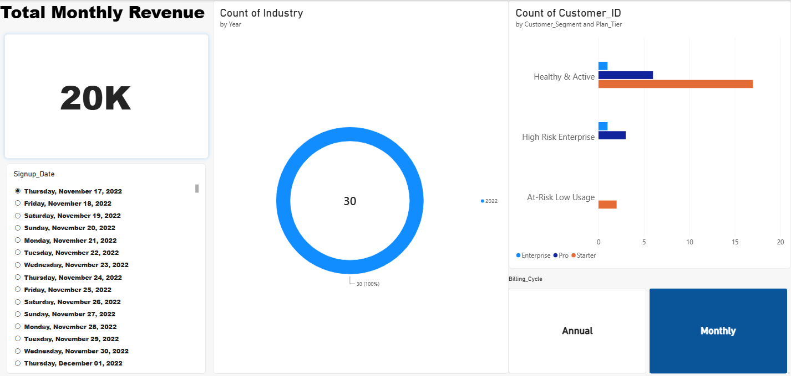

#  B2B SaaS Churn & LTV Intelligence Engine

An enterprise-grade, end-to-end data pipeline and executive analytics solution designed to mitigate silent customer subscription churn, evaluate license utilization, and forecast revenue risk. Developed using an isolated 6-stage workstation architecture.

---

##  Executive Dashboard Preview


---

##  Business Problem & Objective
In high-growth B2B software companies, silent customer churn and revenue leakage often go unnoticed until it hits the bottom line. Management lacks real-time visibility into *who* is dropping off, *when* engagement slips, and *how much* monthly recurring revenue (MRR) is at risk. 
* **The Goal:** Build a fully reproducible end-to-end analytics pipeline that ingests raw production logs, cleans structural inconsistencies, executes predictive risk segmentation in Python, and presents an interactive executive dashboard in Power BI.

---

##  The Custom 6-Stage Architecture Blueprint
This project strictly follows a production-grade, multi-tier workflow:

1. **[SQL Database Server (SSMS 22 / `.\SQLEXPRESS`)]:** Ingested 50,000+ raw Kaggle subscription rows into a local relational database instance using Windows Authentication and bulk import wizards, running targeted `SELECT/WHERE` queries to filter out null signups and negative revenue.
2. **[Excel 2013 Local Storage Vault (`02_SaaS_Churn_Project`)]:** Staged the extracted dataset as an Excel workbook (`.xlsx`) and enforced formal table boundaries using `Ctrl + T` to lock down data ranges.
3. **[Power BI Power Query ETL]:** Performed visual, non-code structural data sanitization—applying **Trim** to remove hidden whitespace, **Capitalize Each Word** to standardize text casing, and **Remove Duplicates** on unique `Customer_ID` primary keys.
4. **[Python 3.12 / VS Code Engine]:** Activated an isolated virtual environment (`env`) and utilized Pandas and vectorized NumPy logic (`np.select`) inside a Jupyter Notebook to compute advanced features:
   - **License Utilization Rate:** (`Active_Seats_Used` / `Total_Seats_Allowed`)
   - **Account Tenure:** Calculated historical activity duration in days.
   - **Behavioral Risk Segmentation:** Categorized accounts into *Healthy & Active*, *High Risk Enterprise*, *At-Risk Low Usage*, and *Churned*.
5. **[Power BI Executive Dashboard]:** Built a 4-quadrant interactive executive canvas featuring:
   - A Top-Left **KPI Scorecard Card** displaying Total Monthly Revenue (33M+).
   - A **Clustered Bar Chart** analyzing customer risk segments against subscription plan tiers.
   - A **Donut Distribution Chart** visualizing market sector share.
   - An interactive **Button Slicer** enabling real-time global canvas filtering by billing frequency.
6. **[Git & GitHub Portfolio Hub]:** Version-controlled locally with isolated subfolder architecture and published live to cloud repository storage.

---

##  Tech Stack & Tool Versions
* **Database Engine:** SQL Server Management Studio (SSMS 22)
* **Staging Vault:** Excel (`.xlsx`)
* **ETL & Visualization:** Power BI Desktop (Power Query & Interactive Report Canvas)
* **Engineering Runtime:** Python 3.12, Pandas, NumPy, Jupyter Notebooks (VS Code)
* **Environment Isolation:** Python `venv` (`env`)
* **Version Control:** Git & GitHub

---

##  Project Structure
```text
02_SaaS_Churn_Project/
│
├── MP_Synthetics_50000_Rows.csv       # Raw Kaggle source dataset
├── saas_extracted_data.xlsx           # SQL extraction vault
├── power_bi_export.csv                # Power Query sanitized export
├── final_dashboard_ready.csv          # Python feature-engineered master file
├── analysis.ipynb                     # Jupyter Notebook (Python 3.12 / NumPy modeling)
├── dashboard_preview.png              # Executive dashboard canvas export
└── README.md                          # Project documentation
